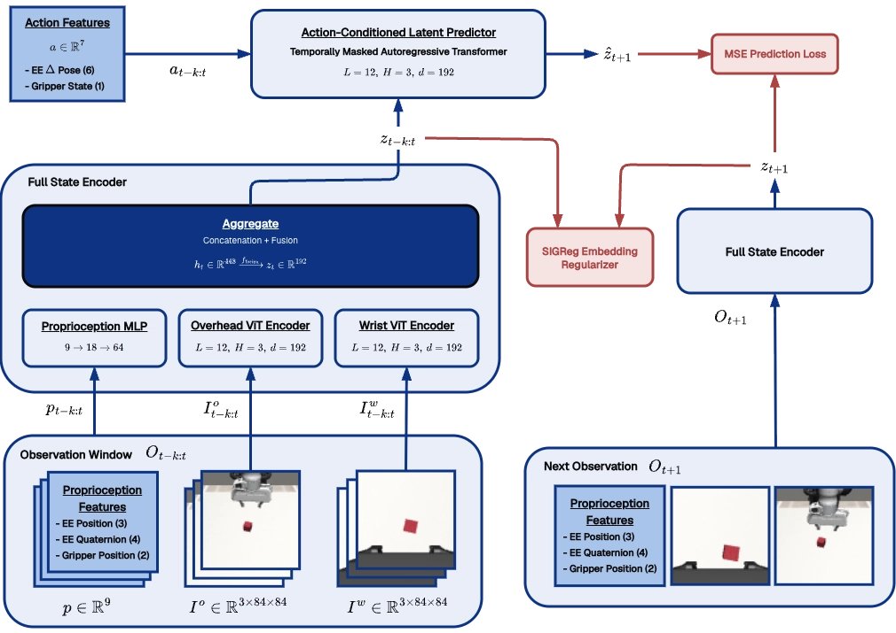
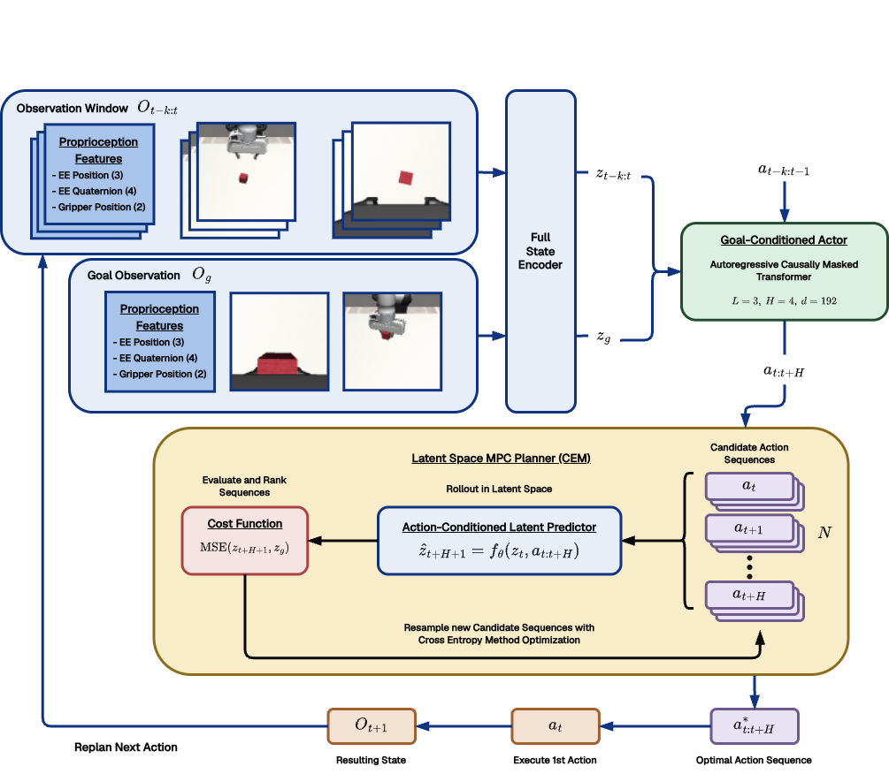

# World-Act: goal-conditioned Lift manipulation

## Overview

Building on the JEPA-based latent world model introduced by Maes et al. (2026) in [*LeWorldModel*](https://arxiv.org/pdf/2603.19312), I extended the architecture to incorporate multi-view visual observations and robot proprioception. I then used the learned action-conditioned dynamics for latent-space planning, with a goal-conditioned actor seeding the MPC planner, forming a low-level controller for simulated lifting tasks.



*Overview of the JEPA Architecture and Training*



*Overview of the MPC Planner during inference*

Read more about the project [here](https://kartikbudihal.xyz/projects/jepa-world-models).

## Local installation

Run from the repository root. Use Python 3.10 for the pinned collection/simulation stack:

```bash
conda create -n world-act python=3.10
conda activate world-act
git submodule update --init --recursive
python -m pip install -r requirements.txt
python -m pip install -r requirements-sim.txt
python -m pip install -e ./robosuite -e ./robomimic -e ./mimicgen
```

Local collection uses MuJoCo 2.3.2; the Colab rollout setup uses 3.2.6 for newer
Python wheels. Match collection/evaluation versions where possible; physics and
rendering can differ. SpaceMouse collection requires the appropriate device
driver/HID permissions and device IDs in Robosuite macros. A keyboard collector
is also available. Colab users can follow the notebooks' own installation cells.

Finally, apply the included dependency patches for MimicGen Lift support and the
Robomimic camera-rendering fix. No manual file copying is needed:

```bash
python scripts/apply_sim_patches.py
```

The script checks dependency versions and refuses conflicting edits. Details are
in [patches/README.md](patches/README.md).

## Data pipeline

- **Collect:** `src/datasets/robot/collect_human_data_mouse.py` records Lift demonstrations using a SpaceMouse.
- **Prepare:** `src/datasets/robot/process_demos.py` combines source demonstrations and prepares them for MimicGen.
- **Expand:** `src/datasets/robot/generate_dataset.py` generates additional demonstrations with MimicGen.
- **Rechunk:** `src/datasets/robot/rechunking.py` optimizes dataset storage for faster training reads.
- **Process:** `src/datasets/robot/processing_actor.py` creates `data/robot/actor/demo_actor.hdf5` with goal-conditioned samples.
- **Upload:** Run `processing_actor.py --upload-only --repo-id USERNAME/DATASET` using your saved Hugging Face login.
- **Evaluation data:** Run `collect_eval.py`, then `process_eval.py` in `src/datasets/robot/` to create `evals.hdf5` with automatic grasp labels.

## Training and evaluation

- **Training:** `src/train/train_primary.py` jointly trains the world model and actor; edit `configs/default_primary.yaml` or select another config with `--config`.
- **Resume:** Add `--resume` to continue training; the epoch count specifies additional epochs.
- **Inference:** `src/inference/run_primary.py` loads models and `evals.hdf5` from the run directory and saves pass/fail videos.
- **Planner:** Choose `--planner-mode arcem` (actor-residual CEM), `direct` (actor only), or `cem` (CEM only).

## Notebooks

- **Train:** [train_primary.ipynb](notebooks/train_primary.ipynb) provides standalone Colab training with Hugging Face downloads and settings in the training cell.
- **Evaluate:** [run_primary.ipynb](notebooks/run_primary.ipynb) provides Colab rollouts with Drive setup and planner controls included.
- **Compute:** Experiments used an L4 GPU; slower GPUs increase planning latency.

Legacy experiments are preserved on the `archive` branch; dependencies retain their upstream licenses.
